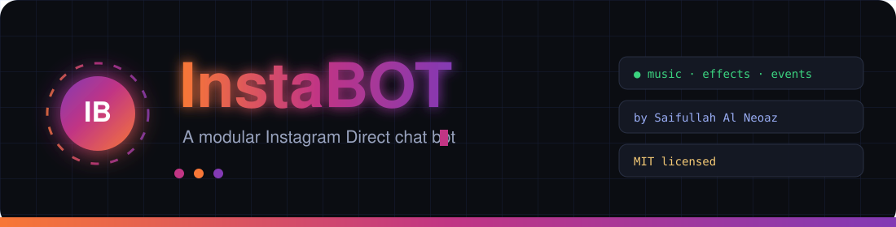
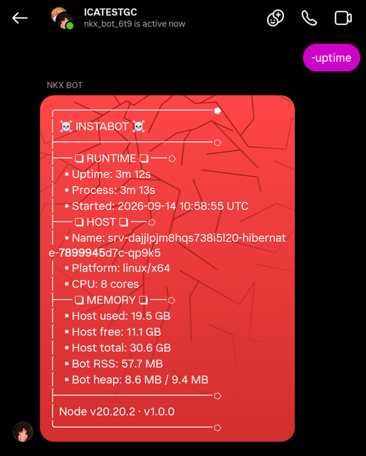

<div align="center">



# InstaBOT

**A modular Instagram Direct chat bot powered by [`ig-chat-api`](https://github.com/lazyneoaz/ig-chat-api).**

Send text, music stickers, animated text effects, photos, audio and video — with prefix commands,
events, roles, cooldowns and pluggable custom commands.

[](LICENSE)


[](https://github.com/lazyneoaz/Insta-Bot)
[](https://github.com/lazyneoaz/Insta-Bot/fork)
[](https://github.com/lazyneoaz/Insta-Bot/stargazers)

### ⭐ If this project helps you, please [fork it](https://github.com/lazyneoaz/Insta-Bot/fork) and give it a [star](https://github.com/lazyneoaz/Insta-Bot/stargazers) — it means a lot!

</div>

---

## ⭐ Support the work

InstaBOT is built and maintained by **Saifullah Al Neoaz** and shared for free.
If you find it useful, the best ways to say thanks:

- ⭐ **[Star the repo](https://github.com/lazyneoaz/Insta-Bot/stargazers)** — it takes a second and really helps.
- 🍴 **[Fork it](https://github.com/lazyneoaz/Insta-Bot/fork)** — build your own version and keep the credits intact.
- 🐛 **[Open an issue](https://github.com/lazyneoaz/Insta-Bot/issues)** with bugs or ideas.
- 💬 **[Join the support group on Instagram](https://ig.me/j/AbY6Ttx_acOoE6wA/)** — ask questions and get help from the community.

Your star is not required to use it — but it is the fuel that keeps it maintained. Thank you! 🙏

---

## Features

- **Prefix commands** with aliases, categories and per-command cooldowns
- **Roles** — user, box admin, bot admin — enforced by the dispatcher
- **Rich sending** — text, replies, reactions, unsend, typing indicator
- **Animated effects** — Instagram power-up text effects and avatar character effects
- **Music stickers** — search a song and attach it, with a pluggable music server
- **Media** — photos, audio and video from a URL, path, Buffer or stream (no temp files)
- **Events** — message, reply, reaction, plus `join` / `leave` welcome and goodbye messages
- **Custom commands & events** — drop files into `commands/` (`events/`) or load them at runtime with `cmd`
- **Command suggestions** — a typo like `-pign` gets a "Did you mean: -ping ?" hint
- **Ban / whitelist / admin-only** controls
- **Online journal** — one JSON line per interval so you can watch uptime
- **No dashboard, no database server** — just JSON files and a cloud-friendly runtime

---

## Screenshots

<table>
  <tr>
    <td width="33%" valign="top">
      
      <p align="center"><sub><b>Runtime status</b> — <code>-uptime</code> reports uptime, host, memory and Node version without leaving the chat.</sub></p>
    </td>
    <td width="33%" valign="top">
      
      <p align="center"><sub><b>Membership</b> — <code>-adduser</code> adds a member and the <code>join</code> event greets them automatically.</sub></p>
    </td>
    <td width="33%" valign="top">
      
      <p align="center"><sub><b>Music stickers</b> — <code>-music</code> searches, lists numbered picks and sends the chosen track.</sub></p>
    </td>
  </tr>
</table>

---

## Quick start

InstaBOT does **not** log in to Instagram itself. It connects to your deployed
**ig-chat-api-server** over HTTP + SSE, so you only need that server's URL and token
(never local cookies, never a local login).

```bash
# 1. Install dependencies (none required at runtime)
npm install

# 2. Point the bot at YOUR deployed server. Set both values in config.json:
#      "server": {
#        "url":   "https://<your-server-host>",   # e.g. the Render/Railway URL
#        "token": "<IG_TOKEN from the server>"    # must match the server's IG_TOKEN
#      }
#    Or set the environment variables IG_API_SERVER and IG_API_TOKEN.
#    The environment ALWAYS wins over config.json, so a fork can never end up
#    pointing at whoever published the repo.

# 3. Adjust prefix / adminBot / language in config.json

# 4. Run
npm start

# 5. Optional: run the test suite
npm test
```

---

## Deploy to Render / Railway

A `Dockerfile` is included. Both platforms can build it directly:

- **Render:** *New → Web Service* → connect this repo → Environment: **Docker** → deploy.
- **Railway:** *New Project → Deploy from GitHub* → it detects the `Dockerfile` → deploy.

The bot works out of the box: `config.json` already points at the shared
ig-chat-api-server. The only thing you must supply is **your own cookies**.

| Variable | Required | Meaning |
| --- | --- | --- |
| `IG_API_SERVER` | — | Only to use a *different* server than the shared one in `config.json` |
| `IG_API_TOKEN` | — | The token for that server (must equal its `IG_TOKEN`) |
| `IG_ADMIN_BOT` | — | Comma-separated account id(s) allowed to run admin commands |

> **One shared server, many accounts.** The `server.url` and `server.token` in
> `config.json` are the **same for every bot** — they are global, not per-user.
> One ig-chat-api-server instance hosts many Instagram accounts at once, and each
> bot is identified by the **account id (`ds_user_id`) inside its own cookies**,
> which it pushes to the server. The server reports that id back and the bot
> adopts it. So the token is a shared access key, not a personal secret, and no
> bot ever drives another account.
>
> `IG_API_SERVER` / `IG_API_TOKEN` override the values in `config.json`; set them
> only if you run a *separate* server (your own deployment) rather than the
> shared one.

> **Per-session secret (automatic).** The shared token authenticates you to the
> server, but it must not let one bot act as another. When your bot pushes its
> cookies the server also returns a random **`sessionToken`**, which the bot
> sends on every later call. You never set it — it is adopted automatically, just
> like the id — and a bot that does not hold it cannot be addressed by anyone
> else, even with the shared token.

> **Your cookies are a password.** `account.txt` is git-ignored. Copy
> `account.example.txt` to `account.txt` locally, or set the cookies as secrets
> on the host. Never commit them. Your cookies are the only thing that decides
> which account your bot runs as.

> **No bot id to configure.** The server identifies each session by the account's
> own Instagram id (`ds_user_id` in the cookies) and returns that id to the bot,
> which adopts it automatically. There is no `IG_BOT_ID` and no `server.botId`.

> **Bot admins are per-deployment.** `adminBot` ships empty. Put your own
> Instagram id there (or set `IG_ADMIN_BOT=id1,id2`) to allow admin-only
> commands for your account.

---

## Login

InstaBOT connects to a **remote ig-chat-api-server** with a URL + token. The bot
sends its own Instagram cookies to that server, so you can keep cookies in
`account.txt` (or an `IG_COOKIES` env var) **on the bot** — no need to configure
them on the server too.

### Mode A — Remote server (recommended, deployed)

Set both values (or the environment fallbacks) and the bot is ready:

```json
"server": {
  "url": "https://<your-server-host>",
  "token": "<IG_TOKEN from the server>",
  "timeout": 60000
}
```

On connect the bot reads its cookies — `IG_COOKIES` if set, else `account.txt` —
and sends them to the server (`POST /cookies`). The server replies with the
session id it assigned (the account's Instagram id), and the bot uses it for the
event stream and every request. **There is nothing to set for the session id.**

> **How the bot finds its session.** The server derives the id from the cookies'
> `ds_user_id`, so the bot always lands on the session that owns its cookies —
> even after a restart, with no configuration and no chance of a
> "wrong bot id" mismatch.

> **Which cookies win?** The server's own sources (`accounts/<id>.txt`,
> `IG_ACCOUNTS`, `IG_COOKIES` on the *server*) take priority; the bot's pushed
> cookies are a fallback. Either model works — pick one place to manage them.
> There is no session id to set on the bot, even for a custom name: the server
> reports the id it filed the cookies under and the bot adopts it.

Environment fallbacks: `IG_API_SERVER`, `IG_API_TOKEN`.

```bash
IG_API_SERVER="https://<your-server-host>" \
IG_API_TOKEN="<IG_TOKEN from the server>" \
npm start
```

Example (replace with your real deploy):

```
IG_API_SERVER=https://ig-chat-api-server.onrender.com
IG_API_TOKEN=<the same long secret you set as the server's IG_TOKEN>
```

### Mode B — Direct (cookies, local development only)

> **Requires the private `ig-chat-api` package.** It is not on the public npm
> registry, so `npm install` will not fetch it. Obtain it from the maintainer and
> place it in `node_modules/ig-chat-api` (or add a local `file:` dependency in
> `package.json`). Without it, leave `server.url`/`server.token` empty only if you
> intend to see a clear startup error. **Mode A (remote server) is the supported
> deployment and needs no local package.**

The bot ships with `account.txt` for pasting your Instagram cookies — open it,
replace the placeholder line with your cookies, and save. Leave
`server.url`/`server.token` empty in `config.json` to run in this direct mode.
Cookie formats accepted:

**JSON array**

```json
[
  { "key": "sessionid", "value": "…", "domain": "instagram.com", "path": "/" },
  { "key": "ds_user_id", "value": "…", "domain": "instagram.com", "path": "/" },
  { "key": "csrftoken", "value": "…", "domain": "instagram.com", "path": "/" }
]
```

**Cookie header string**

```
sessionid=…; ds_user_id=…; csrftoken=…
```

**Netscape file** — export from the *Cookie-Editor* browser extension.

`sessionid` and `ds_user_id` are required. `account.txt` ships with the project
and holds your cookies — keep it private and never push your real cookies.

The bridge is `auth.js` at the project root. It is signature-compatible with the direct
`ig-chat-api` login, so commands work identically: calls travel to the server over HTTP (RPC) and
realtime events arrive over Server-Sent Events (SSE). Media (path, Buffer, stream or URL) is read
locally and streamed to the server as bytes.

---

## Configuration

`config.json` is JSON with comments allowed as plain string fields (see `notes` keys).

| Key | What it does |
| --- | --- |
| `botName` | Name shown in notices |
| `prefix` | Command prefix, e.g. `-` |
| `language` | UI language (`en`) |
| `adminBot` | Array of user IDs with bot-admin rights |
| `env.token` / `env.url` | Optional secrets/endpoints; overridden by the environment |
| `server.url` / `server.token` | Connect to a remote ig-chat-api server (skips cookies) |
| `server.timeout` | Server request timeout in ms |
| `music.enable` | Turn the song search (both `music` and `sing`) on/off |
| `music.apiUrl` / `music.apiToken` | Your own music server (blank = use Instagram's catalogue) |
| `account.proxy` / `account.userAgent` | Optional HTTP(S) proxy and UA |
| `adminOnly` | Restrict the bot to admins |
| `whiteList` | Restrict which users/threads can use the bot |
| `cooldown.default` | Default seconds between a user's commands |
| `onlineStatus` | JSON-line uptime journal |
| `database.dir` | Folder for the JSON user/thread store |

### Environment variables (optional)

Anything left blank in `config.json` can be supplied by the environment — handy for containers:

```
INSTABOT_TOKEN=…
INSTABOT_URL=…
```

Values in `config.json` take precedence. Only the `INSTABOT_*` names are read: hosts such as
Render set a bare `URL` (the service's own public URL), and reading that as an API endpoint
silently broke commands like `sing`, which then called the bot's own host and got a 404.

Other environment variables:

| Variable | Purpose |
| --- | --- |
| `IG_API_SERVER` / `IG_API_TOKEN` | Server URL and token (see above) |
| `IG_COOKIES` | Instagram cookies to send to the server (wins over `account.txt`). Accepts a header string, JSON array, or Netscape text |
| `IG_MAX_MEDIA_BYTES` | Largest local media file the bot will upload, in bytes (default 5 MB). Base64 adds ~33%, so keep it under the server's `IG_MAX_BODY_BYTES` (default 8 MB) |
| `PORT` | Port for the built-in status server (default `8080`). Set `PORT=0` to disable it (pure worker mode) |

### Status server

The bot ships a tiny HTTP server so a host such as Render finds an open port
(otherwise it reports *"No open ports detected"*). It also gives you a health
check:

```bash
curl "http://<host>:<PORT>/health"
# {"ok":true,"service":"instabot","online":true,"userID":"...","commands":21,"events":4}
```

The bot itself only makes outbound connections; this server is stateless and does
nothing but answer that request. Set `PORT=0` to turn it off when running as a
background worker that does not need a port.


### Music server

Set `music.apiUrl` to your own search endpoint. `{query}` is replaced with the song text, otherwise
`?query=` is appended. The response may be `{ tracks: [] }`, `{ results: [] }`, `{ data: [] }` or a
bare array; each entry needs at least an audio cluster/asset id plus a title.

```json
"music": {
  "enable": true,
  "apiUrl": "https://music.example.com/search?q={query}",
  "apiToken": "your-token"
}
```

Both song commands read the same `music.apiUrl`:

- **`music`** (`stickermusic`, `sm`, `m`) attaches a 20-30s **Instagram music sticker** and needs the
  IG audio cluster/asset id fields (`audioClusterID` / `audioAssetID`).
- **`sing`** streams the **full song** as an audio attachment. With `apiUrl` blank it uses
  **Instagram's own music catalogue**, which already returns a full-length audio URL
  (`progressive_download_url`) — so `sing` works with no configuration. A custom server is optional
  and needs a downloadable URL on each result under any common key (`url`, `downloadUrl`,
  `audioUrl`, `previewUrl`, `streamUrl`, `link`, `src`, or a nested `url`/`src`). The server converts
  the audio to the format Instagram accepts, so the API may return MP3, M4A or AAC.

---

## Commands

| Command | Aliases | Role | Description |
| --- | --- | --- | --- |
| `help` | `h`, `menu` | user | List commands and usage |
| `ping` | `pong` | user | Online / latency check |
| `uptime` | `up`, `runtime` | user | How long the bot has been running |
| `uid` | `id` | user | Return a user id (numeric, `@handle`, username, profile URL, or reply) |
| `info` | `whois`, `userinfo`, `profile` | user | Show a user's profile details |
| `pfp` | `pp`, `profilepic`, `avatarof` | user | Send a user's profile picture |
| `echo` | `say` | user | Repeat text |
| `effect` | `fx` | user | Power-up text effect |
| `avatarfx` | `avfx`, `avatar-effect` | user | Avatar character effect |
| `music` | `stickermusic`, `sm`, `m` | user | Search and send a song as an Instagram music sticker |
| `sing` | — | user | Search and send the **full song** as audio |
| `ai` | `ritchi`, `chatbot` | user | Conversational AI with memory; reply to continue |
| `img` | `image`, `sendimg` | user | Send an image by URL |
| `anisearch` | `anivid`, `animevid` | user | Send a random anime TikTok video |
| `joke` | `dadjoke` | user | Random joke |
| `admin` | `adminbot` | bot admin | Add / remove / list bot admins |
| `ban` | `unban` | bot admin | Ban or unban a user |
| `adduser` | `addtouser`, `addmember` | bot admin | Add a user to the current thread |
| `removeuser` | `kick`, `removemember` | bot admin | Remove a user from the current thread |
| `whitelist` | `wl` | bot admin | Manage the whitelist |
| `prefix` | `setprefix` | user (view) / bot admin (change) | Show the prefix; bot admins can change it |
| `avatar` | `setavatar`, `setavt` | bot admin | Change the bot avatar |
| `bio` | `setbio`, `biography` | bot admin | Change the bot bio |
| `cmd` | `command` | bot admin | Install / uninstall / load / reload / list commands |
| `eval` | `ev`, `js` | bot admin | Evaluate JavaScript |
| `shell` | `exec`, `sh`, `terminal` | bot admin | Run a shell command |

### Examples

```
-effect fire Hello world
-avatarfx laugh That was funny
-music blinding lights      # search and send a 20-30s music sticker
-music 2                    # send sticker #2 from the last search
-sing blinding lights       # search and send the FULL song as audio
-sing 2                     # send full song #2 from the last search
-ai tell me a short story    # reply to the answer to keep chatting
-adduser @friend              # add a user to this group
-removeuser 123456789         # remove a user (or reply to their message)
```

### No-prefix commands

A few commands work **without** the prefix so you can never lock yourself out:

- `prefix` — anyone can run it to see the current prefix; a bot admin can run `prefix !` to change it.
- The bot-admin commands (`admin`, `ban`, `adduser`, `removeuser`, `prefix`, `whitelist`, `cmd`,
  `avatar`, `bio`, `eval`, `shell`) also run without the prefix for **bot admins only**. Normal users
  still need the prefix.

```
prefix            # -> "The current prefix is `-`."
prefix !          # -> "Prefix changed to `!`."
```

Any command can opt in by adding `noPrefix: true` to its `config`. Add `noPrefixRole: 0` too if you
want everyone (not just bot admins) to use it without the prefix.

---

## Custom commands & events

Drop a `.js` file straight into `commands/` (or `events/`) and it is loaded on start — no config, no
sub-folder. You can also manage them live with `cmd`.

```text
InstaBOT/
├─ commands/            <- put your own command files here
│  ├─ ping.js
│  ├─ sing.js
│  └─ mycommand.js      <- just add a file
└─ events/              <- event scripts (message, join, leave, ...)
```

**Scaffold a command**

```
-cmd template          # prints a starter command
-cmd template event    # prints a starter event
```

**Manage at runtime**

```
-cmd list              # show loaded commands and events
-cmd load mycommand    # load commands/mycommand.js (commands/ is the default)
-cmd reload mycommand  # reload after editing
-cmd unload mycommand  # remove it from the registry
-cmd load myevent --event
-cmd install https://raw.githubusercontent.com/owner/repo/main/command.js
```

URL installs automatically use the filename from the URL. If a downloaded file
cannot load, for example because it requires an unavailable dependency, the bot
reports the error and removes the broken file instead of failing silently.

A command module looks like this:

```js
module.exports = {
  config: {
    name: "hello",
    aliases: ["hi"],
    author: "Neoaz 🐊",
    category: "custom",
    cooldown: 3,
    role: 0,
    description: { en: "Say hello" },
    usage: { en: "{p}hello <name>" }
  },

  onStart: async function ({ message, args, event, api, usersData, config }) {
    return message.reply(`Hello ${args.join(" ") || "there"}!`);
  }
};
```

**Full example — a `roll` command with a reply handler**

Create `commands/roll.js` (there is a ready-made copy in the repo), then load it with `-cmd load roll`
(or just restart — files in `commands/` load on boot). It rolls a dice and lets you reply `pick <n>` to save a favourite number.

```js
module.exports = {
  config: {
    name: "roll",
    aliases: ["dice"],
    author: "you",
    category: "custom",
    cooldown: 3,
    role: 0,
    description: { en: "Roll a dice and remember a favourite number" },
    usage: { en: "{p}roll [sides]" }
  },

  onStart: async function ({ message, args, event, usersData, setReplyHandler }) {
    const sides = Number(args[0]) > 1 ? Math.floor(Number(args[0])) : 6;
    const value = 1 + Math.floor(Math.random() * sides);

    // Ask the user to reply to THIS message so we can catch their answer.
    const sent = await message.reply(`Rolled a d${sides}: ${value}\nReply "pick <n>" to save a favourite.`);

    setReplyHandler(async ({ event: replyEvent, message: replyMessage }) => {
      const [action, n] = String(replyEvent.body || "").trim().split(/\s+/);
      if (action !== "pick" || !/^\d+$/.test(n)) return;
      const data = (usersData.get(replyEvent.senderID) || {}).data || {};
      usersData.update(replyEvent.senderID, { data: Object.assign({}, data, { favourite: Number(n) }) });
      await replyMessage.reply(`Saved your favourite number: ${n}`);
    }, sent && sent.messageID);
  }
};
```

Two things to note in that example:

- `setReplyHandler(handler, sent.messageID)` — always pass the message the user must reply to
  (`sent.messageID`). Without it the handler listens on the command message itself and your reply
  will never match.
- `usersData.get(id)` / `usersData.update(id, patch)` — simple per-user JSON storage for persistence.

Every command receives: `api`, `message`, `event`, `args`, `commandName`, `role`, `usersData`,
`threadsData`, `userData`, `threadData`, `config`, `registry`, `setReplyHandler` and
`setReactionHandler`.

The `message` helper exposes:

| Method | Description |
| --- | --- |
| `message.send(form)` | Send to the thread |
| `message.reply(form)` | Reply to the triggering message |
| `message.unsend(id?)` | Remove a message for everyone |
| `message.react(emoji, id?)` | React to a message |
| `message.effect(text, style)` | Animated power-up text effect |
| `message.avatarEffect(text, style)` | Avatar character effect |
| `message.music(track)` | Attach a music sticker |
| `message.musicSearch(query)` | Search the music catalogue |
| `message.typing()` | Typing indicator (returns a stop function) |

`form` may be a string or `{ body, attachment, url, effect, avatarEffect }`. Attachments are routed
to image/audio/video automatically and accept a URL, path, Buffer or stream.

### Events

An event module declares `eventType` and defines `onEvent`:

```js
module.exports = {
  config: { name: "onMessage", eventType: "message", category: "system" },
  onEvent: async function ({ api, event, message, config }) {
    // runs for every matching event
  }
};
```

Available `eventType` values: `message`, `message_reply`, `message_reaction`, `message_unsend`,
`read_receipt`, `typ`, `join` and `leave`.

### Welcome & leave messages

InstaBOT ships two event scripts, `events/onJoin.js` and `events/onLeave.js`, that greet people
added to a group and say goodbye when someone leaves. Configure them in `config.json`:

```json
"welcome": {
  "enable": true,
  "message": "Welcome %1 to %2! 👋",
  "selfMessage": "Thanks for inviting me to %2 💋. Type {prefix}help to see all available commands.",
  "threadIDs": []
},
"leave": {
  "enable": true,
  "message": "%1 left %2. 👋",
  "threadIDs": []
}
```

- `%1` is the member's **username** (`@handle`) when it can be resolved, `%2` is the thread name.
- `selfMessage` is sent when the **bot itself** is added to a group — it thanks the inviter instead of
  welcoming itself. `{prefix}` is replaced with the live command prefix, `%2` with the group name.
- Leave `threadIDs` empty to announce in every group; list thread IDs to limit it.
- Set `enable` to `false` to turn either one off.

```
Welcome @alice to Test Group! 👋
Thanks for inviting me to Test Group 💋. Type -help to see all available commands.
@alice left Test Group. 👋
```

> Any message with both text and media sends the **text first**, then the attachment (so titles and
> details read above the image/audio/video).

---

## Project layout

```
InstaBOT/
├─ index.js              banner + start
├─ auth.js               remote ig-chat-api server bridge (token + url)
├─ Dockerfile            container image for Render / Railway
├─ config.json           bot settings (server.url + server.token live here)
├─ account.txt           Instagram cookies — paste yours here (direct mode)
├─ assets/banner.svg     animated README banner
├─ src/
│  ├─ bot.js             login · listener · reconnect
│  ├─ dispatcher.js      prefix · roles · cooldowns · handlers
│  ├─ message.js         send/reply/react/media/effect/music
│  ├─ commandLoader.js   validates & loads scripts
│  ├─ config.js          config + cookie parsers
│  ├─ database.js        JSON store (users/threads)
│  ├─ onlineStatus.js    JSON-line online journal
│  ├─ languages.js       language helper
│  ├─ utils.js           helpers (mediaKind, …)
│  └─ logger.js          colored console logger
├─ commands/             commands (drop your own .js files here)
├─ events/               event scripts (message, reaction, join, leave, …)
├─ languages/en.js       strings
└─ test/                 unit tests + live send test
```

---

## Testing

```bash
npm test                      # 111 unit tests, no credentials needed
node test/live-send.js <tid>  # sends real DMs through the configured server
```

The unit suite mocks the API, so it runs anywhere. `live-send.js` performs a real text effect,
avatar effect, music search and music sticker send, and writes `instabot-live-send.json` with the
result. It uses `config.server.url` + `config.server.token` when set, otherwise local cookies.

---

## Security notes

- `eval` and `shell` run arbitrary code on the host. They are **bot-admin only** and the bot admin
  list lives in `config.json` — keep it private. Prefer to disable or remove them for untrusted use.
- `account.txt` ships with a placeholder — paste your real cookies into it and keep it private.
  Never commit or share your real cookies.
- Never commit the server token. Keep it in the environment (`IG_API_TOKEN`), not in `config.json`.

---

## Credits

**Author:** Saifullah Al Neoaz — [@lazyneoaz](https://github.com/lazyneoaz)

- GitHub: [https://github.com/lazyneoaz](https://github.com/lazyneoaz)
- Project: [InstaBOT](https://github.com/lazyneoaz/Insta-Bot)
- Support group: [Join on Instagram](https://ig.me/j/AbY6Ttx_acOoE6wA/)
- Powered by: [`ig-chat-api`](https://github.com/lazyneoaz/ig-chat-api) and [`ig-chat-api-server`](https://github.com/lazyneoaz/ig-chat-api-server)

**Contributors:**

- **NZ R.** — `ai` (Ritchi), `adduser`, `removeuser`, and the Goatbot-V2-style `eval`.

If you fork or reuse this project, please keep this credit and the MIT license intact.

---

## License

MIT © [Saifullah Al Neoaz](https://github.com/lazyneoaz) — see [LICENSE](LICENSE).

---

<div align="center">

### ⭐ Enjoying InstaBOT? [Fork](https://github.com/lazyneoaz/Insta-Bot/fork) it and [leave a star](https://github.com/lazyneoaz/Insta-Bot/stargazers)!

[](https://github.com/lazyneoaz/Insta-Bot)
[](https://github.com/lazyneoaz/Insta-Bot/fork)
[](https://github.com/lazyneoaz/Insta-Bot/stargazers)
[](https://ig.me/j/AbY6Ttx_acOoE6wA/)

[](LICENSE)

</div>

## GitHub storage (no MongoDB needed)

Users, threads and `commands/cache/autoreact.json` are mirrored to a GitHub repo so data survives redeploys.

1. Create a **private** repo (e.g. `my-bot-data`) and a token with *Contents: Read & write* on it.
2. Set env vars on your host: `GITHUB_TOKEN=...` and `GITHUB_REPO=owner/my-bot-data` (optional: `GITHUB_BRANCH`, `GITHUB_PATH`).
3. Start the bot. On boot it pulls the data; changes are pushed ~20s after they happen, and on shutdown.

Never put the token in a public repo.
